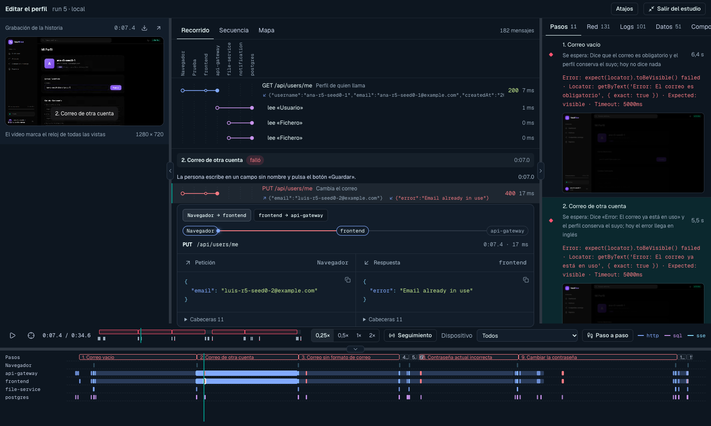
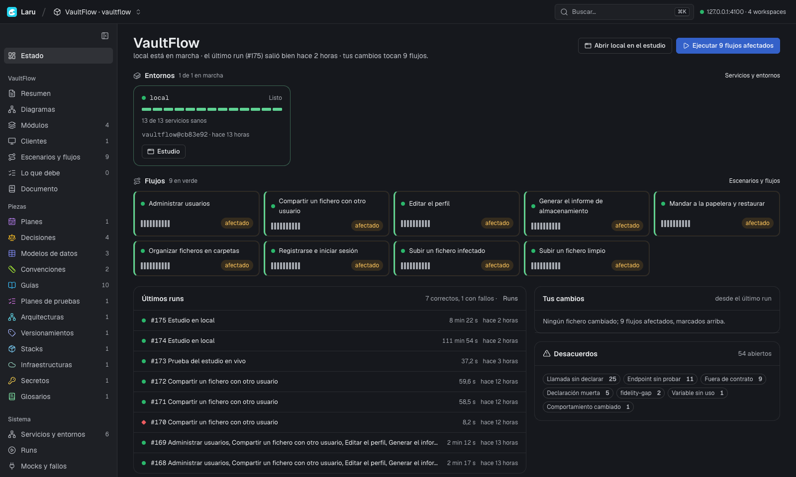
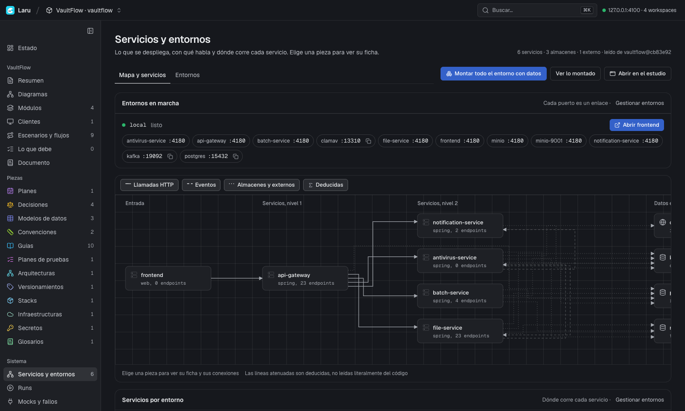
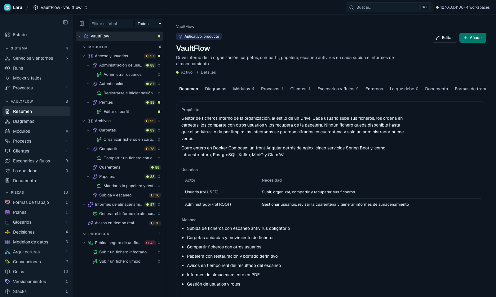
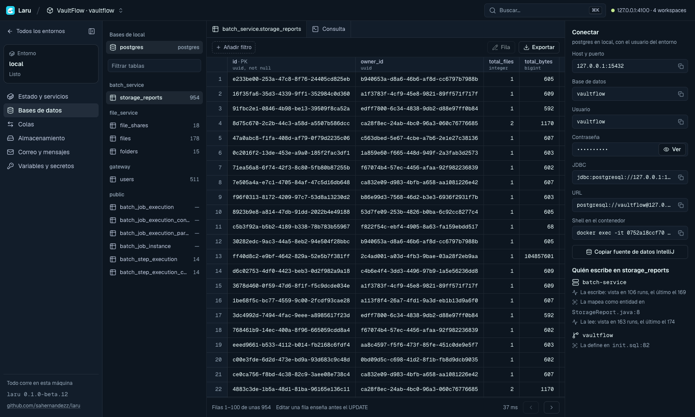
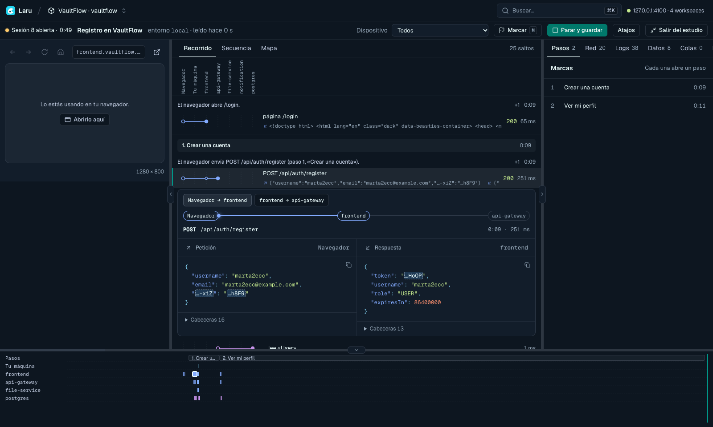
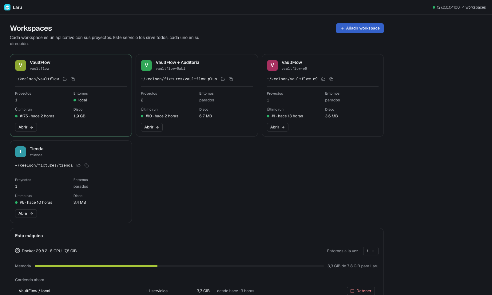

<p align="center">
  
</p>

<h1 align="center">Laru</h1>

<p align="center">
  <b>Entiende, documenta y prueba tu aplicativo entero desde tu máquina.</b><br>
  El mapa del sistema leído del código, entornos con datos, pruebas grabadas con la traza de cada servicio
  y el contexto exacto para tu agente de IA.
</p>

<p align="center">
  
  
  
  
</p>

<p align="center">
  
</p>

> **Beta.** Laru ya se usa a diario sobre aplicativos reales, pero puede cambiar entre versiones `0.x`.
> Cuéntanos lo que falle en [Issues](https://github.com/sahernandezz/laru/issues).

---

## Qué es

Un aplicativo de verdad son varios repositorios, una docena de servicios, bases de datos, colas y un front.
Entender qué pasa cuando alguien pulsa un botón obliga a abrir cinco proyectos, levantar todo a mano
y leer logs sueltos.

Laru vive **alrededor** de los repositorios de tu aplicativo, nunca dentro de ellos:

- **Lee el código** y dibuja el sistema: quién llama a quién, qué tablas escribe cada servicio, qué temas publica.
- **Levanta el sistema entero** en Docker, con datos, y te deja explorar sus bases de datos, colas, ficheros y correos.
- **Graba cada prueba** con su vídeo y la traza de todo lo que pasó por dentro: cada petición, cada consulta SQL con sus filas, cada mensaje.
- **Mantiene la documentación viva**, con un estándar, anclada al código y avisando de lo que deja de ser cierto.
- **Da a tu agente de IA** (Claude Code, Codex u otro) el contexto exacto antes de tocar nada.

Todo corre en tu máquina. Nada sale de ella: ni el código, ni los datos, ni los correos que tu aplicativo envía.

## Funcionalidades

### Un estado de un vistazo

Qué entornos están en marcha, qué flujos pasan, qué tocan tus cambios y qué desacuerdos hay entre
la documentación y el código.



### El mapa del sistema, leído del código

Laru lee cada proyecto (Spring, Node, Angular, React y más) y construye el mapa:
- servicios y endpoints;
- llamadas HTTP y eventos;
- almacenes y externos.

Cada línea del mapa dice de dónde sale: si está en el código, si se observó en una prueba o si se dedujo.



### Documentación viva, con un estándar

El aplicativo, sus módulos, flujos, escenarios, decisiones, modelos de datos, guías y arquitectura son
**piezas** con un estándar. Cada pieza:
- tiene una nota de completitud y dice lo que le falta;
- se valida en CI con `laru check`;
- incluye diagramas con su clase y sus reglas.

Los diagramas se editan en un lienzo (Excalidraw) o como texto (Mermaid).



### Entornos con datos, para explorar

`laru up` levanta el sistema entero, construye solo lo que cambió y espera a que esté listo. Desde la interfaz exploras:
- **Bases de datos:** Postgres, MySQL, MongoDB y Redis, con consultas, filtros y edición que enseña el `UPDATE` antes de aplicarlo.
- **Colas:** Kafka y RabbitMQ, con temas, mensajes recientes y publicación.
- **Almacenamiento:** S3 y MinIO.
- **Correo y SMS:** atrapados en local, para leerlos y abrir sus enlaces.
- **Variables y secretos:** cada clave dice qué nivel gana y quién la lee; los secretos van cifrados en disco.

Para volver a un estado, `laru snapshot` lo guarda y `laru reset` lo restaura en segundos.



### Pruebas grabadas, con la traza de todo el sistema

Cada flujo es una prueba de extremo a extremo con Playwright. Cada run guarda:
- el vídeo;
- los pasos;
- la traza de todo el sistema: cada petición HTTP con su cuerpo, cada consulta SQL con las filas que devolvió,
  cada mensaje de Kafka, los eventos del servidor y los logs de cada servicio.

`laru test --affected` corre solo los flujos que toca tu cambio. Si un flujo se comporta distinto del comportamiento aprobado, Laru te lo dice.

### El estudio: un run como en un editor de vídeo

Todo a la vez, sin hacer scroll:
- el vídeo de la prueba;
- el **Recorrido**: cada petición en orden, bajo la acción que la provocó, con su camino por los servicios y lo que llevó y recibió;
- la secuencia y el mapa;
- una línea de tiempo con una pista por servicio.

Para moverte: `Espacio` reproduce, `←` `→` pasan de mensaje en mensaje y `P` recorre paso a paso.
La imagen de arriba del todo es el estudio.

### En vivo

Usas el aplicativo tú mismo, dentro de Laru o en tu navegador, mientras Laru lee la traza del sistema entero.
Marcas lo que vas haciendo con `M`, y cada acción aparece con todo lo que provocó.

Al terminar, la sesión se guarda como un run y se convierte en el borrador de un flujo o de un escenario.



### Compartido con tu equipo por git

El workspace es un repositorio git más: súbelo y tu equipo trabaja sobre la misma documentación.
- **Va en git:** la documentación, los entornos, los mocks y, en `evidence/`, el último run que pasó de cada flujo, con su traza y su vídeo.
- **Los proyectos:** un proyecto con git va solo como referencia (su URL y su rama en `laru.yaml`, y el commit verificado en `laru.lock`), porque su código ya está en su repositorio. Una carpeta sin git va como copia en `projects/<nombre>/`: cada `laru map` la actualiza sin `.env`, sin lo ignorado y sin ficheros de más de 50 MB.
- **Se queda en tu máquina:** los runs fallidos o antiguos, las capturas en bruto, los datos de los entornos y los secretos sin cifrar.

Quien clona el workspace ejecuta `laru sync` para clonar los proyectos con git y `laru map` para leerlos; una carpeta la lee de su copia en `projects/`, salvo que la enlace a la suya con `laru repo link`. Al abrirlo, ve cada flujo con su último resultado y abre su estudio sin haberlo ejecutado.

Cada flujo que pasa sustituye su evidencia en `evidence/`. Para un workspace que ya tenía runs, `laru runs share` comparte el último que pasó de cada flujo.

### Todos tus aplicativos en un solo sitio

Un servicio local sirve todos tus workspaces, cada uno en su dirección. También dice cuánta memoria
usan los entornos en marcha y cuántos pueden correr a la vez.



### Para tu agente de IA

Abre `claude` (o Codex) en el workspace y ya sabe dónde está todo:
- **Servidor MCP:** `.mcp.json` lo declara, con herramientas para el mapa, la documentación, los entornos, los runs y las sesiones en vivo.
- **Guías del workspace:** `CLAUDE.md` y `AGENTS.md` explican cómo se documenta y cómo se prueba.
- **Contexto:** `laru context <pieza>` da al agente lo justo antes de tocar algo.
- **Hooks para Claude Code:** avisan de lo que un cambio puede romper.

## Cómo correrlo

### Requisitos

- **Sistema:** macOS, Linux o Windows. En Windows corre directamente en PowerShell o `cmd`, o dentro de WSL2 si lo prefieres (ver [En Windows](#en-windows)).
- **Node.js 24** o superior y **pnpm 10**.
- **Docker** con Docker Compose.
- **Git.**
- **Opcionales:**
  - Google Chrome, para usar el aplicativo dentro de Laru en las sesiones en vivo;
  - `ffmpeg`, para unir en un solo vídeo las pantallas de una prueba con varios usuarios.

### Instalación

```bash
git clone https://github.com/sahernandezz/laru.git
cd laru
pnpm install
pnpm build                                                     # la interfaz web
ln -s "$PWD/apps/cli/bin/laru.js" "$(npm prefix -g)/bin/laru"   # deja `laru` en tu PATH
laru doctor                                                    # comprueba Docker, Compose y lo demás
```

### Primeros pasos

```bash
# 1. Un workspace para tu aplicativo, fuera de sus repositorios
laru init ~/laru/mi-app --app mi-app --docs-language es
cd ~/laru/mi-app

# 2. Sus proyectos: se clonan, o se enlaza una copia que ya tienes
laru repo add git@github.com:mi-org/api.git
laru repo add ~/code/portal

# 3. Laru lee el código y construye el mapa
laru map

# 4. La interfaz, en tu navegador
laru open
```

### En Windows

Hay dos formas, y las dos funcionan:

- **Directamente en Windows:** instala Docker Desktop, Node 24, pnpm y Git, y usa `laru` desde PowerShell o `cmd` como en macOS o Linux.
- **Dentro de WSL2:** útil si ya trabajas en Linux o quieres Docker sin Docker Desktop. Los pasos:

1. **Instala WSL2 con Ubuntu:** en PowerShell, `wsl --install -d Ubuntu`. A partir de aquí, todo se hace en la terminal de Ubuntu.
2. **Instala Docker**, de una de estas dos formas:
   - **Docker Desktop:** activa *Settings → Resources → WSL integration* para tu distribución.
   - **Docker Engine dentro de Ubuntu,** sin Docker Desktop:
     - Instálalo siguiendo [la guía de Docker para Ubuntu](https://docs.docker.com/engine/install/ubuntu/).
     - Después de instalar Laru (paso 5), ejecuta `laru doctor --fix`. Deja Docker configurado para WSL:
       - activa systemd en `/etc/wsl.conf`, para que WSL arranque Docker solo;
       - arranca el demonio;
       - añade tu usuario al grupo `docker`.

       Enseña cada comando con `sudo` antes de ejecutarlo. Si activa systemd, ejecuta `wsl --shutdown` en PowerShell y vuelve a abrir Ubuntu.
3. **Instala Node 24 y pnpm** en Ubuntu.
4. **Guarda Laru y tus workspaces en el disco de Linux** (`~/…`), no en `/mnt/c`. Ahí git, Docker y la lectura del código van mucho más rápido.
5. **Comprueba la instalación:** `laru doctor` revisa Docker, WSL y lo demás, aunque todavía no tengas un workspace. Si algo falla, dice cómo arreglarlo, y `laru doctor --fix` arregla Docker.
6. **Abre la interfaz** en el navegador de Windows. La dirección que da `laru open` (`http://127.0.0.1:4100/…`) funciona tal cual, porque WSL reenvía los puertos.

`laru open` arranca el servicio local si no está en marcha y te da la dirección del workspace,
por ejemplo `http://127.0.0.1:4100/w/mi-app/`. Desde ahí:

```bash
laru env init local --from api:docker-compose.yml   # un entorno a partir del compose de un proyecto
laru up                                             # levantarlo con datos
laru test                                           # correr los flujos y guardar su evidencia
laru session start --browser                        # usar el aplicativo en vivo
```

`laru --help` lista todos los comandos.

## Privacidad y seguridad

- **Nada se instala dentro de tus repositorios.** El workspace guarda la documentación y la configuración aparte.
- **El servicio solo escucha en tu máquina.** Responde únicamente a `127.0.0.1` y `localhost`. Rechaza peticiones de otras páginas y que lo incrusten en otra web.
- **En una máquina compartida:** `laru serve --token` pide iniciar sesión.
- **Secretos:** van cifrados en disco y enmascarados en las trazas, los logs y los cuerpos que se muestran.
- **Correos y SMS:** los que envía tu aplicativo en un entorno se quedan en ese entorno.

## Licencia

Laru se publica con la [Functional Source License 1.1, con licencia futura Apache 2.0](LICENSE.md) (FSL‑1.1‑ALv2).

- **Gratis:** puedes usarlo, leerlo, modificarlo y compartirlo para todo menos competir con él. Eso incluye usarlo en tu empresa, en tus proyectos, para aprender o para investigar.
- **Reservado:** venderlo u ofrecerlo como producto o servicio que compita con Laru.
- **Licencia futura:** cada versión pasa a Apache 2.0 a los dos años de publicarse.

¿Quieres usarlo de una forma que la licencia no cubre? Escríbenos.

## Versiones

Las versiones siguen [Versionado Semántico](https://semver.org/lang/es/) y cada una tiene su etiqueta `vX.Y.Z`.
Lo que cambia en cada versión está en el [CHANGELOG](CHANGELOG.md).
